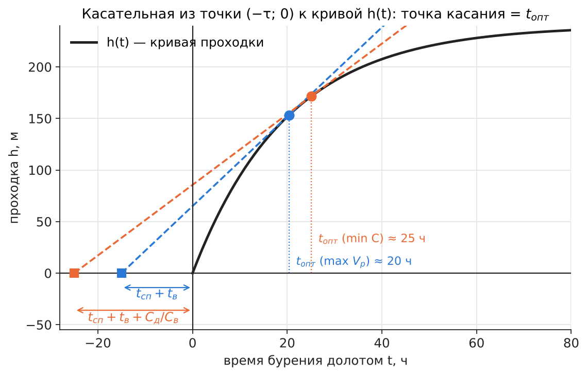
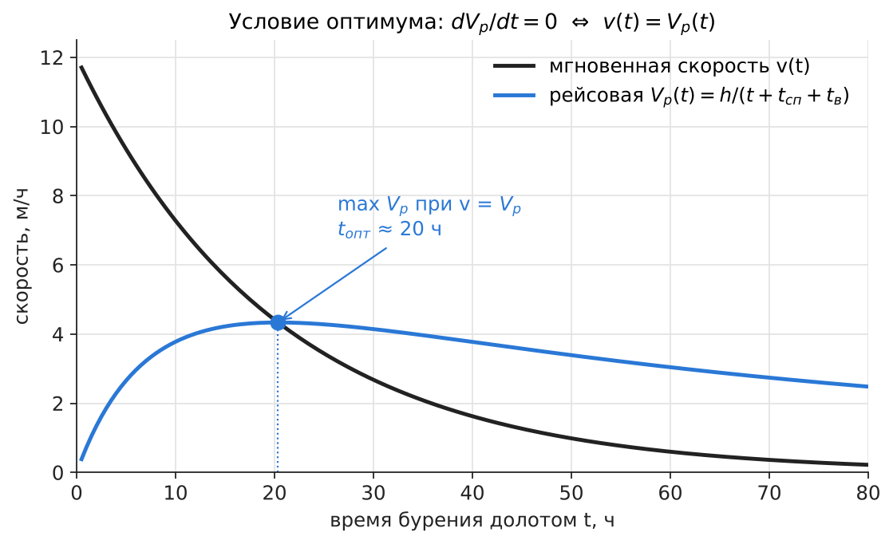
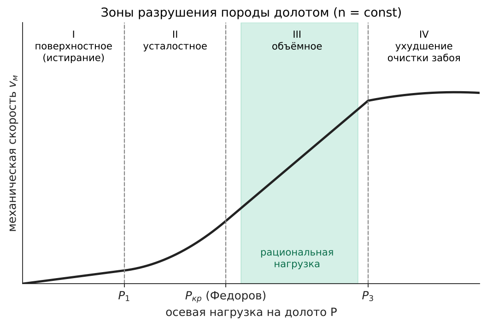
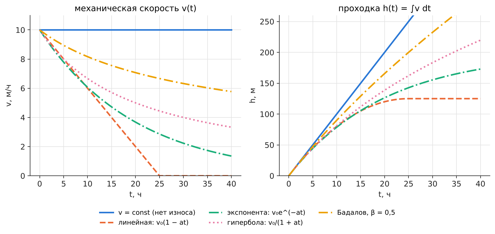
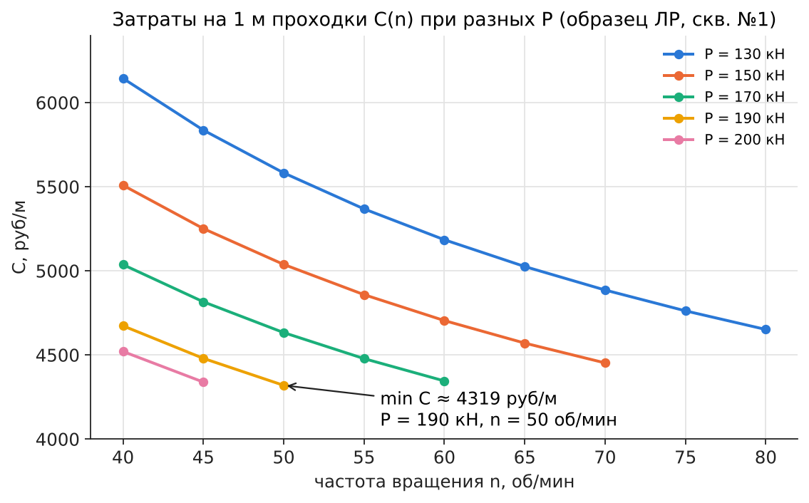
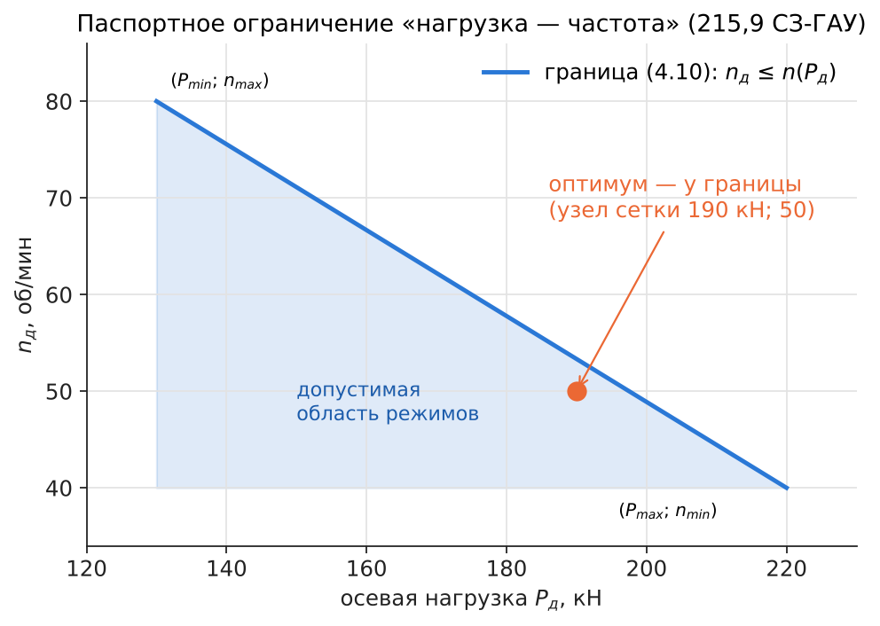

# ЛР №4 — ответы на защиту

**«Выбор оптимального режима и рационального типа шарошечного долота при роторном способе бурения»**

Источник: пособие Балицкий В.П., Храброва О.Ю. «Технологические расчёты на ПК при бурении глубоких скважин» (РГУ, 2007) — `ЛР/Пособие_ЛР_Балицкий_Храброва_2007.pdf`, ЛР №4 = стр. 29–39.

Формат защиты: 2 вопроса письменно, 7–10 мин. Поэтому у каждого вопроса есть:
- **Писать** — что переписать на листок (формулы и 3–6 фраз);
- **Рисовать** — какой график набросать от руки (сам график ниже);
- **Если спросят** — 1–2 фразы для устного дополнения.

Пометки: **[П]** — есть в пособии (стр. указана); **[О]** — из общего курса (в пособии этого нет; если в лекции записано иначе — пиши как в лекции).

PDF-версия этого файла (формулы и графики гарантированно отображаются): `ЛР/ЛР4/ЛР4_защита.pdf`.

---

## Обозначения (общие для всех ответов)

| Обозн. | Смысл | Ед. |
|---|---|---|
| $h$ | проходка на долото | м |
| $t_\text{б}$ | время механического бурения (стойкость долота) | ч |
| $t_\text{сп}$ | время спуско-подъёмных операций (СПО) | ч |
| $t_\text{в}$ | время подготовительно-заключительных и вспомогательных работ | ч |
| $C_\text{в}$ | стоимость 1 ч работы буровой установки | руб/ч |
| $C_\text{д}$ | стоимость долота | руб |
| $P_\text{д}$, $n_\text{д}$ | осевая нагрузка, частота вращения долота | Н (кН), об/мин |
| $v(t)$ | мгновенная механическая скорость | м/ч |

---

## 1. Взаимосвязь критериев оптимизации режима бурения

**Писать.** Основные критерии оптимизации:

$$V_\text{м}=\frac{h}{t_\text{б}}\ (\max),\qquad h\ (\max),\qquad V_\text{р}=\frac{h}{t_\text{б}+t_\text{сп}+t_\text{в}}\ (\max),$$

$$C=\frac{C_\text{д}+C_\text{в}\,(t_\text{б}+t_\text{сп}+t_\text{в})}{h}\ (\min).$$

Связь между ними:

$$V_\text{р}=V_\text{м}\,\frac{t_\text{б}}{t_\text{б}+t_\text{сп}+t_\text{в}},\qquad C=\frac{C_\text{в}}{V_\text{р}}+\frac{C_\text{д}}{h}.$$

- $V_\text{м}$ — локальный критерий, не учитывает СПО; годится на малых глубинах (СПО короткие).
- $h$ — важен на больших глубинах, где $t_\text{сп}$ велико.
- $V_\text{р}$ учитывает и скорость, и проходку → **критерий скорости строительства**.
- $C$ — **общий (экономический) критерий**, им пользуемся в ЛР №4 [П, стр. 29–30].
- Если $C_\text{д}\ll C_\text{в}(t_\text{б}+t_\text{сп}+t_\text{в})$, то $\min C \approx \max V_\text{р}$. Учёт стоимости долота сдвигает оптимум в сторону более длительной работы долота (см. вопр. 2).

**Если спросят.** При $t_\text{сп}+t_\text{в}\to 0$ рейсовая скорость → механической. [О]

---

## 2. Графо-аналитический метод определения оптимального времени работы долота

**Писать.**
1. Строим кривую проходки $h(t)$ (по данным бурения; кривая выпуклая — скорость падает из-за износа долота).
2. По оси $t$ **влево от нуля** откладываем отрезок:
   - для $\max V_\text{р}$: $\tau=t_\text{сп}+t_\text{в}$;
   - для $\min C$: $\tau_C=t_\text{сп}+t_\text{в}+C_\text{д}/C_\text{в}$ (стоимость долота, пересчитанная в часы работы буровой).
3. Из точки $(-\tau;\,0)$ проводим **касательную** к $h(t)$. Абсцисса точки касания — $t_\text{опт}$.

Почему: $V_\text{р}=\dfrac{h(t)}{t+\tau}=\operatorname{tg}\varphi$ — тангенс угла наклона луча из $(-\tau;0)$ в точку кривой; он максимален у касательной. Для $C$ аналогично: $C=C_\text{в}\,\dfrac{t+\tau_C}{h(t)}$ минимально при том же условии касания.

**Рисовать** (рис. 1): ось $t$, выпуклая $h(t)$, точка $-\tau$ слева, касательная, $t_\text{опт}$.

**Если спросят.** $\tau_C>\tau$ ⇒ $t_\text{опт}$ по стоимости больше, чем по рейсовой скорости. [О]

---

## 3. Аналитический метод определения оптимального времени работы долота

**Писать.** Задаём аналитически $v(t)$, тогда $h(t)=\int_0^t v\,dt$. Ищем максимум

$$V_\text{р}(t)=\frac{h(t)}{t+\tau},\qquad \tau=t_\text{сп}+t_\text{в}\quad(\text{для }\min C:\ \tau_C=\tau+C_\text{д}/C_\text{в}).$$

$$\frac{dV_\text{р}}{dt}=0\ \Rightarrow\ v(t_\text{опт})\,(t_\text{опт}+\tau)=h(t_\text{опт})\ \Rightarrow\ \boxed{v(t_\text{опт})=V_\text{р}(t_\text{опт})}$$

Долото поднимают, когда **мгновенная скорость упала до рейсовой**.

Пример (линейное падение скорости): $v=v_0(1-at)$, $h=v_0\left(t-\dfrac{at^2}{2}\right)$ ⇒

$$at^2+2a\tau t-2\tau=0\ \Rightarrow\ t_\text{опт}=-\tau+\sqrt{\tau^2+\dfrac{2\tau}{a}}.$$

Для экспоненты $v=v_0e^{-at}$: $\ e^{at_\text{опт}}=1+a(t_\text{опт}+\tau)$ — решается подбором/графически.

**Рисовать** (рис. 4): падающая $v(t)$ и «горб» $V_\text{р}(t)$; они пересекаются в вершине горба.

**Если спросят.** Если $v=\text{const}$ (нет износа вооружения), $V_\text{р}$ растёт всё время ⇒ долото работает до отказа опоры. [О]

---

## 4. Зоны разрушения породы в зависимости от нагрузки. Формула Федорова–Феногенова

**Писать.** При $n=\text{const}$ зависимость $v_\text{м}(P)$ имеет зоны:
- **I — поверхностное разрушение (истирание):** контактное давление меньше твёрдости породы, $v_\text{м}$ мала, растёт ~ линейно.
- **II — усталостное (объёмно-поверхностное):** порода разрушается после многократных ударов зубьев, $v_\text{м}$ растёт быстрее линейного.
- **III — объёмное разрушение:** давление на контакте ≥ твёрдости, за 1 удар скалывается лунка; $v_\text{м}$ растёт резко ⇒ **рациональная зона**.
- **IV — замедление роста:** зубья погружены полностью, хуже очистка забоя от шлама.

Нагрузка начала объёмного разрушения (формула **Федорова–Феногенова**) [О]:

$$P_\text{кр}=\alpha\,p_\text{ш}\,S_\text{к},\qquad S_\text{к}=\frac{D\,\eta\,\delta}{2}\ \Rightarrow\ P_\text{кр}=\frac{\alpha\,p_\text{ш}\,D\,\eta\,\delta}{2},$$

$p_\text{ш}$ — твёрдость породы по штампу, Па; $S_\text{к}$ — площадь контакта зубьев с забоем, м²; $D$ — диаметр долота, м; $\eta$ — коэффициент перекрытия забоя (≥1); $\delta$ — ширина притупления зубьев, м; $\alpha$ — коэффициент забойных условий (дифф. давление, раствор).

**Выбор рациональной нагрузки:** $P_\text{кр}\le P_\text{д}\le P_\text{доп}$ (паспорт долота, табл. 5 прил. [П, стр. 85]); окончательно — по минимуму $C$, т.к. с ростом $P$ падает стойкость долота (формула 4.3).

**Рисовать** (рис. 3): S-образная кривая, 4 зоны, отметить $P_\text{кр}$.

**Если спросят.** По мере износа $\delta$ растёт ⇒ $P_\text{кр}$ растёт ⇒ для изношенного долота нужна большая нагрузка. [О]

---

## 5. Аппроксимация эмпирических зависимостей $v_\text{м}$ от параметров режима

**Писать.** По данным бурения (пары «режим — скорость») подбирают аналитическую формулу. Чаще всего степенная (в ЛР — формулы 4.2, 4.3 [П, стр. 30]):

$$V_\text{м}=k\,n_\text{д}^{\alpha}P_\text{д}^{\beta},\qquad t_\text{б}=\frac{A}{n_\text{д}^{\delta}P_\text{д}^{\varphi}}.$$

Порядок аппроксимации:
1. Выбрать вид формулы (по форме облака точек).
2. Линеаризовать логарифмированием: $\ \ln V_\text{м}=\ln k+\alpha\ln n_\text{д}+\beta\ln P_\text{д}$.
3. Найти коэффициенты методом наименьших квадратов (минимум суммы квадратов отклонений).
4. Проверить точность (средняя ошибка, коэффициент корреляции).

В ЛР показатели взяты готовыми из литературы: $\alpha=0{,}8$; $\beta=1{,}4$; $\delta=0{,}7$; $\varphi=1{,}2$, а $k$ и $A$ — **адаптационные коэффициенты**, вычисляются по фактическим средним данным пачки (4.5, 4.6). [П, стр. 30–31]

**Если спросят.** $\alpha<1$ — с ростом $n$ уменьшается время контакта зуба с породой; $\beta>1$ — объёмное разрушение (зона III). [О]

---

## 6. Стойкость опоры и вооружения шарошечного долота. Влияющие факторы

**Писать.** Стойкость долота $t_\text{б}$ — время механического бурения до отработки. Долото поднимают по **износу вооружения** (зубьев) или **опоры** (подшипников шарошек) — что наступит раньше. Желательна **равностойкость** опоры и вооружения.

Модель стойкости (ЛР, [П, стр. 30]): $\ t_\text{б}=\dfrac{A}{n_\text{д}^{0{,}7}P_\text{д}^{1{,}2}}$ — с ростом $P$ и $n$ стойкость падает.

Факторы [О]:
- **Опора:** осевая нагрузка (главный), частота вращения, тип опоры (скольжения/качения, герметизированная маслонаполненная — стойче), диаметр долота (размер подшипников), абразивность и смазывающие свойства раствора, температура, вибрации.
- **Вооружение:** абразивность и твёрдость породы, частота вращения (путь трения зубьев), нагрузка, материал зубьев (фрезерованные с наплавкой / твердосплавные вставки), очистка забоя (гидравлика, твёрдая фаза раствора).

**Если спросят.** В образце ЛР $\varphi=1{,}2>\delta=0{,}7$ ⇒ нагрузка сильнее снижает стойкость, чем обороты.

---

## 7. Формула Бадалова и зависимости $v_\text{м}$ от времени

**Писать.** Из-за износа зубьев скорость падает во времени. Типовые законы ($v_0$ — начальная скорость, $a$ — темп падения):

| Закон | $v(t)$ | $h(t)$ |
|---|---|---|
| постоянная | $v_0$ | $v_0t$ |
| линейная | $v_0(1-at)$ | $v_0\left(t-\frac{at^2}{2}\right)$ |
| экспоненциальная | $v_0e^{-at}$ | $\frac{v_0}{a}\left(1-e^{-at}\right)$ |
| гиперболическая | $\dfrac{v_0}{1+at}$ | $\frac{v_0}{a}\ln(1+at)$ |

**Формула Бадалова** — обобщённая [О]:

$$v(t)=\frac{v_0}{(1+at)^{\beta}},\qquad h(t)=\frac{v_0}{a(1-\beta)}\left[(1+at)^{1-\beta}-1\right].$$

Показатель $\beta$ характеризует темп износа: $\beta=0$ — постоянная скорость, $\beta=1$ — гипербола (предел), с ростом $\beta$ кривая приближается к экспоненциальной. Чем больше $\beta$ (абразивнее порода), тем раньше надо поднимать долото.

**Рисовать** (рис. 2): веер падающих кривых $v(t)$.

---

## 8. Общий подход к оптимизации процесса механического бурения

**Писать.** Оптимизация = выбор управляемых параметров, дающих экстремум критерия при соблюдении ограничений.
1. **Критерий (целевая функция):** $\min C$ на 1 м или $\max V_\text{р}$ (вопр. 1).
2. **Управляемые параметры:** тип долота, $P_\text{д}$, $n_\text{д}$, расход и свойства раствора, время работы долота $t_\text{б}$.
3. **Математическая модель:** $v_\text{м}=f(P,n,\ldots)$ и стойкость $t_\text{б}=f(P,n,\ldots)$ (вопр. 9).
4. **Ограничения:** паспорт долота $P_\text{min}…P_\text{max}$, $n_\text{min}…n_\text{max}$ и связь (4.10); мощность привода, прочность колонны, гидравлика.
5. **Поиск экстремума:** перебор по сетке (как в ЛР), аналитически (производная = 0), графически.

Этапы: **проектирование** режима по данным пробуренных скважин в пачках одинаковой буримости (ЛР №2 → №3 → №4) → **оперативная оптимизация** при бурении (уточнение коэффициентов модели, адаптация) → **момент подъёма** долота (вопр. 2–3). [О]

---

## 9. Математические модели процесса механического бурения

**Писать.** Модель процесса бурения — система уравнений, связывающая показатели бурения с параметрами режима и свойствами породы:
1. уравнение **механической скорости** $v_\text{м}=f(P,n,Q,\rho,\text{порода},\text{износ})$;
2. уравнения **износа** вооружения и опоры (стойкость $t_\text{б}$);
3. **целевая функция** ($C$ или $V_\text{р}$) и **ограничения**.

Виды моделей [О]:
- **аналитические (физические)** — из механики разрушения породы (напр., критическая нагрузка Федорова–Феногенова);
- **эмпирические (статистические)** — степенные регрессии по промысловым данным;
- **адаптивные** — эмпирическая структура + коэффициенты уточняются по фактическим данным бурения.
Примеры: модель Галле–Вудса, модель Бургойна–Янга; в ЛР — трёхпараметрические зависимости (4.2), (4.3) [П, стр. 30].

---

## 10. Математическая модель ЛР №4 и последовательность выполнения

**Модель** [П, стр. 30–33]:

$$C=\frac{C_\text{в}}{V_\text{м}}+\frac{C_\text{в}(t_\text{сп}+t_\text{в})+C_\text{д}}{V_\text{м}\,t_\text{б}}\quad(4.1)$$

$$V_\text{м}=k\,n_\text{д}^{0{,}8}P_\text{д}^{1{,}4}\quad(4.2),\qquad t_\text{б}=\frac{A}{n_\text{д}^{0{,}7}P_\text{д}^{1{,}2}}\quad(4.3)$$

Подстановка (4.2), (4.3) в (4.1):

$$C=\frac{B}{n_\text{д}^{0{,}8}P_\text{д}^{1{,}4}}+\frac{D+M}{n_\text{д}^{0{,}1}P_\text{д}^{0{,}2}}\quad(4.4),\qquad B=\frac{C_\text{в}}{k},\ D=\frac{C_\text{в}(t_\text{сп}+t_\text{в})}{kA},\ M=\frac{C_\text{д}}{kA}.$$

**Последовательность:**
1. Исходные данные варианта (табл. 4.1): интервал, $P_\text{д}$, $n_\text{д}$, по 2 скважинам (2 типа долот) — проходки $h_i$, время $t_i$, $C_\text{д}$.
2. По табл. 1–4 приложения: $t_\text{сп}$, $t_\text{в}$.
3. Средние: $\bar h=\dfrac{\sum h_i}{n}$, $\bar t_\text{б}=\dfrac{\sum t_i}{n}$, $\bar V_\text{м}=\dfrac{\bar h}{\bar t_\text{б}}$ (4.7–4.9).
4. Адаптационные коэффициенты:
$$k=\frac{\bar V_\text{м}}{n_\text{д}^{0{,}8}P_\text{д}^{1{,}4}}\ (4.5),\qquad A=\bar t_\text{б}\,n_\text{д}^{0{,}7}P_\text{д}^{1{,}2}\ (4.6)$$
(в пособии в (4.6) опечатка «$t_\text{в}$» — верно $\bar t_\text{б}$, проверено пересчётом образца).
5. $B$, $D$, $M$.
6. Таблица $C(P,n)$: $P$ — от 50 % до 90 % $P_\text{max}$ с шагом 20 кН; $n$ — от $n_\text{min}$ до $n_\text{max}$ с шагом 10 (в образце 5) об/мин; для каждой $P$ — граница частоты по паспорту:
$$n_\text{д}\le\frac{n_\text{min}-n_\text{max}}{P_\text{max}-P_\text{min}}\,(P_\text{д}-P_\text{min})+n_\text{max}\quad(4.10)$$
7. $\min C$ по таблице (функция МИН), графики $C(n)$ при разных $P$ (линейный и столбиковый).
8. То же для скважины №2; сравнить минимумы (функция ЕСЛИ) ⇒ **оптимальный режим и лучший тип долота**.

**Результат образца** [П, стр. 37–39]: скв. №1 (215,9 СЗ-ГАУ) $\min C=4319{,}3$ руб/м при $P=190$ кН, $n=50$ об/мин; скв. №2 (215,9 МСЗ-ГАУ) — 4346,3 руб/м ⇒ лучше долото скв. №1. (Пересчитано скриптом `src/figures.py` — совпадает.)

**Вывод, который полезно сказать:** обе части (4.4) убывают с ростом $P$ и $n$, поэтому минимум $C$ всегда лежит **на границе** допустимой области (4.10) — оптимум ограничен паспортом долота.

---

### Страницы пособия (картинки)
`ЛР/рисунки_пособия/стр30.jpg`, `стр31.jpg`, `стр33.jpg` — формулы 4.1–4.10; `стр37.jpg`–`стр39.jpg` — образец выполнения.
