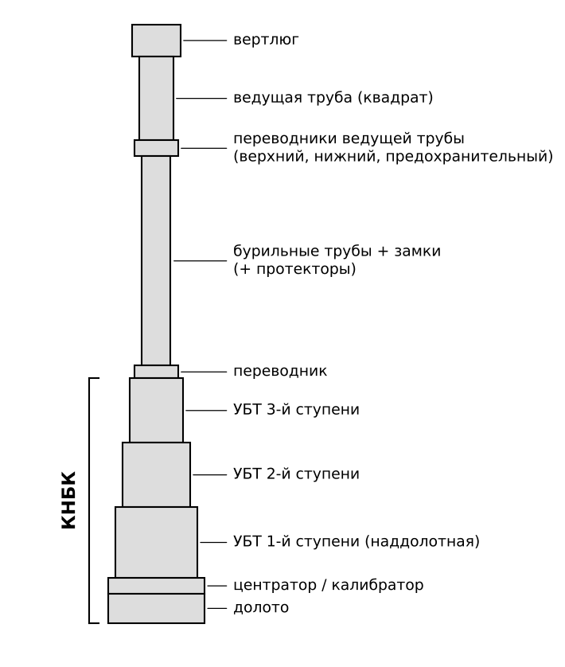
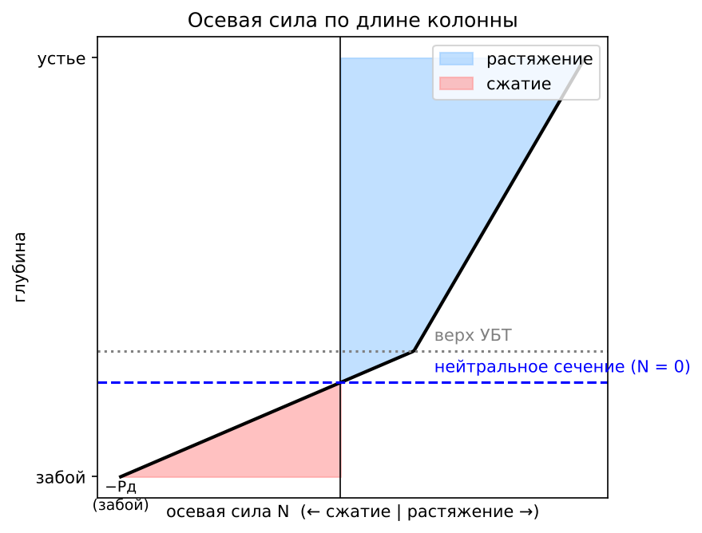
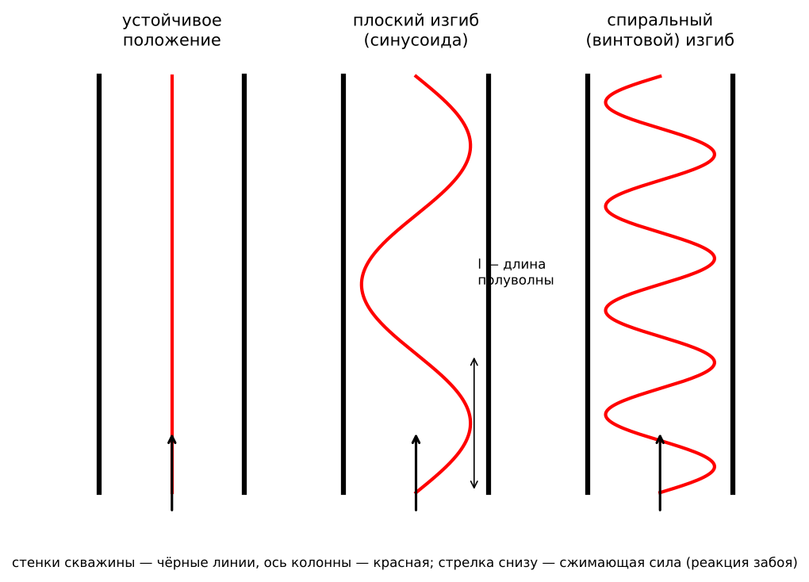
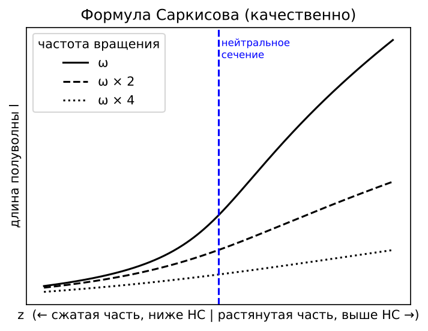

# ЛР №5 — ответы на защиту

**«Проектирование компоновки нижней части бурильной колонны при бурении вертикальных скважин»**

Как пользоваться: на защите дают **один вопрос**. Находишь его номер и переписываешь ответ целиком: текст, формулы, схему. Схему перерисовывай от руки, точные числа не нужны.

Источник: пособие Балицкого и Храбровой (ЛР №5, с. 40–47 брошюры, они же стр. 40–47 PDF). Чего в пособии нет, то взято из общего курса бурения (учебники Сарояна, Саркисова, Булатова); такие места помечены *(общий курс)*.

Обозначения:
- $P_\text{д}$ — осевая нагрузка на долото, Н (кН);
- $D_\text{д}$ — диаметр долота; $d_\text{бт}$ — диаметр бурильных труб; $d_{\text{УБТ}i}$ — диаметр $i$-й ступени УБТ;
- $q_{\text{УБТ}i}$ — масса 1 м УБТ $i$-й ступени, кг/м;
- $l_{\text{УБТ}i}$ — длина ступени, м; $l_\text{УБТ}$ — общая длина УБТ, м;
- $G_\text{зд}$ — масса забойного двигателя, кг; $l_\text{зд}$ — его длина, м;
- $\rho$ — плотность промывочной жидкости, $\rho_\text{м}=7850$ кг/м³ — плотность стали;
- $g=9{,}81$ м/с²; $E$ — модуль упругости стали ($2{,}1\cdot10^{11}$ Па); $I$ — момент инерции сечения трубы.

---

## Вопрос 1. Функции бурильной колонны и её основные элементы

**Бурильная колонна** — это ступенчатый полый вал, который соединяет долото (или забойный двигатель) с наземным оборудованием. Она висит на крюке талевой системы.

**Функции бурильной колонны:**
1. Спускать и поднимать долото и забойный двигатель (СПО).
2. Передавать вращение от ротора к долоту (роторное бурение) или воспринимать реактивный момент забойного двигателя (турбинное бурение, бурение ВЗД).
3. Создавать осевую нагрузку на долото. Её создаёт вес нижней части колонны, то есть УБТ.
4. Подводить промывочную жидкость к долоту и забойному двигателю. По колонне жидкость идёт вниз, а по затрубью поднимается вверх со шламом.
5. Подводить электроэнергию к электробуру.
6. Служить каналом для вспомогательных работ: испытания пластов (ИПТ), ловильных работ, установки цементных мостов, закачки реагентов, спуска приборов, передачи сигналов телеметрии.

**Основные элементы (сверху вниз):**
- **ведущая труба** («квадрат») квадратного или шестигранного сечения; через вкладыши ротора передаёт вращение колонне;
- **переводники ведущей трубы**: верхний, нижний и предохранительный;
- **бурильные трубы** (ТБВ, ТБН, ТБПВ, ТБВК, ТБНК — стальные; ЛБТ — легкосплавные), соединённые **бурильными замками**;
- **УБТ** — утяжелённые бурильные трубы, толстостенные и тяжёлые; создают нагрузку на долото;
- **элементы КНБК**: центраторы, калибраторы, стабилизаторы, переводники, амортизаторы, ясы, обратный клапан;
- **долото**, а при турбинном бурении над ним забойный двигатель.

---

## Вопрос 2. Вспомогательные элементы бурильной колонны, их назначение и конструктивные особенности

Вспомогательными называют элементы колонны, которые не являются бурильными трубами и УБТ.

1. **Ведущая (рабочая) труба.** Сечение квадратное или шестигранное, внутри канал для промывки. Через ротор передаёт крутящий момент колонне и при этом может перемещаться вниз по мере углубления скважины.
2. **Переводники** соединяют элементы с разными резьбами или разными диаметрами.
   - По типу концов: **П** — переходные (ниппель–муфта), **М** — муфтовые (муфта–муфта), **Н** — ниппельные (ниппель–ниппель).
   - **Предохранительный переводник** ставят под ведущей трубой. Изнашивается его резьба, а не резьба ведущей трубы, и меняют дешёвый переводник.
3. **Бурильные замки** (ЗП, ЗН, ЗШ, ЗУ) соединяют бурильные трубы. Состоят из ниппеля и муфты с конической замковой резьбой и упорным торцом. Свинчивать и развинчивать их можно много раз.
4. **Центраторы и стабилизаторы.** Это короткие элементы с лопастями (прямыми или спиральными). Диаметр по лопастям близок к диаметру долота, лопасти наплавлены твёрдым сплавом. Удерживают УБТ по оси скважины, уменьшают изгиб и искривление ствола.
5. **Калибраторы** (лопастные или шарошечные) ставят над долотом. Калибруют стенку ствола до диаметра долота и центрируют долото.
6. **Протекторы** — резиновые кольца на бурильных трубах. Защищают трубы и обсадную колонну от износа при трении.
7. **Амортизаторы (демпферы)** гасят продольные вибрации и удары от долота, особенно на твёрдых породах.
8. **Ясы** (механические и гидравлические) создают удар вверх или вниз, чтобы освободить прихваченную колонну.
9. **Обратный клапан** пропускает жидкость только вниз. Защищает от выброса через трубы и от попадания шлама в забойный двигатель при остановке насосов.
10. **Фильтр** над забойным двигателем задерживает крупные частицы.
11. **Шаровой кран** на ведущей трубе перекрывает канал труб при газонефтеводопроявлении (ГНВП).

---

## Вопрос 3. Требования к бурильной колонне и этапы её расчёта на прочность

**Требования к бурильной колонне:**
1. Достаточная **прочность** на растяжение, сжатие, кручение и изгиб, а также против внутреннего и наружного давления.
2. **Выносливость** (сопротивление усталости) при знакопеременном изгибе во время вращения.
3. **Герметичность** резьбовых соединений, чтобы жидкость не вымывала резьбу.
4. **Минимальная масса** при нужной прочности. От массы зависит нагрузка на вышку и лебёдку и предельная глубина спуска.
5. **Малые гидравлические сопротивления**: гладкий внутренний канал без резких сужений.
6. **Износостойкость** и коррозионная стойкость.
7. Быстрое и надёжное свинчивание и развинчивание, удобство СПО, ремонтопригодность.
8. Колонна должна вписываться в ствол: для промывки и подъёма шлама нужен зазор между колонной и стенкой.

**Этапы расчёта на прочность** (это содержание ЛР №5 и ЛР №6):
1. **Проектирование КНБК** (ЛР №5). Выбирают тип УБТ, число ступеней, диаметры и длины. Условие: вес УБТ в жидкости на 15 % больше нагрузки на долото, тогда бурильные трубы работают только на растяжение.
2. **Расчёт бурильных труб на статическую прочность при растяжении** (ЛР №6). Над УБТ подбирают секции труб: тип, толщину стенки, группу прочности стали (Д, К, Е, Л, М, Р, Т). Самые прочные трубы ставят вверху, потому что там растягивающая сила наибольшая. Должно выполняться условие
$$Q \le \frac{Q_\text{пр}}{n},$$
где $Q$ — растягивающая сила в сечении, $Q_\text{пр}$ — предельная нагрузка трубы, $n$ — коэффициент запаса (около 1,3 в нормальных условиях и 1,4–1,45 в осложнённых).
3. **Проверка на совместное растяжение и кручение** при роторном бурении. Эквивалентное напряжение не должно превышать допустимое:
$$\sigma_\text{экв}=\sqrt{\sigma^2+4\tau^2}\le[\sigma].$$
4. **Проверка на выносливость** при знакопеременном изгибе во вращающейся колонне (роторное бурение).
5. **Проверка на наружное давление** (смятие, например при опорожнении труб во время испытания пластов) и на внутреннее давление.
6. **Проверка в клиновом захвате** ротора: трубу не должно смять клиньями.

---

## Вопрос 4. Типы УБТ, их особенности и области применения

**УБТ (утяжелённые бурильные трубы)** — толстостенные трубы большой массы, 1 м весит от 60 до 490 кг в зависимости от диаметра. Их ставят над долотом, чтобы весом создать осевую нагрузку и сделать низ колонны жёстким. Диаметры УБТ от 73 до 299 мм.

**Типы:**
1. **УБТ горячекатаные (УБТ-Г).** Гладкие по всей длине, из углеродистой или марганцовистой стали, без термообработки. Канал не обрабатывается, поэтому стенка может быть разной толщины, а труба несбалансирована. Замковая резьба нарезана прямо на концах трубы.
   *Применение:* роторное и турбинное бурение на небольших и средних глубинах в нормальных условиях.
2. **УБТС — сбалансированные** (УБТС-1, УБТС-2). Сталь легированная (хромоникельмолибденовая, 40ХН2МА, 38ХН3МФА), термообработанная. Канал высверлен и соосен наружной поверхности, поэтому труба сбалансирована и меньше вибрирует при вращении. Резьбы упрочнены накаткой, есть разгрузочные канавки. Под элеватор и клинья сделаны проточки.
   *Применение:* роторное бурение, глубокие скважины, тяжёлые условия с большими нагрузками и вибрациями. В ЛР №5 справочная таблица дана именно по **УБТС-1**.
3. **Квадратные УБТ** (сечение — квадрат с закруглёнными углами, диаметр по углам почти равен диаметру долота). Очень жёсткие, работают как длинный центратор.
   *Применение:* борьба с искривлением ствола в зонах естественного искривления.
4. **Спиральные УБТ** (со спиральными канавками на наружной поверхности). Площадь контакта со стенкой меньше, поэтому меньше риск дифференциального прихвата, и шлам проходит лучше.
   *Применение:* проницаемые пласты, наклонные скважины.
5. **Немагнитные УБТ** из немагнитной стали.
   *Применение:* в них размещают инклинометр или телесистему (MWD) при наклонно-направленном и горизонтальном бурении, чтобы магнитное поле стальной колонны не искажало замер азимута.
6. **Толстостенные бурильные трубы ТБТ (HWDP)** — промежуточный тип между бурильными трубами и УБТ.
   *Применение:* переходная секция между УБТ и бурильными трубами; в наклонных и горизонтальных скважинах — вместо части УБТ.

---

## Вопрос 5. КНБК, её элементы и назначение

**КНБК (компоновка низа бурильной колонны)** — нижняя часть колонны от долота до бурильных труб.

**Элементы КНБК:**
- долото;
- калибратор и наддолотный центратор (стабилизатор);
- забойный двигатель (турбобур, ВЗД), если бурение турбинное;
- отклонитель или кривой переводник, если бурение наклонное;
- немагнитная УБТ с телесистемой;
- **УБТ** в 1–3 ступени, от большего диаметра внизу к меньшему вверху;
- промежуточные центраторы;
- амортизатор, яс, обратный клапан, фильтр;
- переводники;
- иногда ТБТ — переходная секция к бурильным трубам.

**Назначение КНБК:**
1. **Создать осевую нагрузку на долото** весом УБТ. Нейтральное сечение должно находиться в УБТ, тогда бурильные трубы растянуты и не изгибаются.
2. **Обеспечить жёсткость и устойчивость низа колонны**: уменьшить продольный изгиб и вибрации.
3. **Управлять траекторией ствола**: держать вертикаль или набирать, стабилизировать или снижать зенитный угол.
4. **Обеспечить плавный переход жёсткости** от УБТ к бурильным трубам (условие $d_\text{бт}/d_\text{УБТ}\ge0{,}75$), чтобы на переходе не возникали поломки.
5. Разместить забойный двигатель, телесистему, ясс.

**Типы КНБК по назначению** *(общий курс)*:
- **маятниковая**: центратор на 10–20 м выше долота, ниже него УБТ висит как маятник. Уменьшает зенитный угол и выводит ствол на вертикаль;
- **жёсткая (стабилизирующая)**: 2–3 центратора близко друг к другу. Сохраняет направление ствола;
- **компоновки для набора угла**: отклонитель или центратор у долота работает как точка опоры («рычаг»).

---

## Вопрос 6. Алгоритм определения числа секций (ступеней) УБТ и их диаметров

Порядок по пособию (ЛР №5, с. 41):

1. **Диаметр первой (наддолотной) ступени** берут из справочной таблицы УБТС-1 по диаметру долота. Например, для долот 250,8–269,9 мм берут УБТ 229 мм, для долот 212,7–244,5 мм — УБТ 178 мм.
   *(общий курс)* Обычно $d_{\text{УБТ}1}\approx(0{,}75\ldots0{,}85)\,D_\text{д}$: УБТ должна быть как можно толще для жёсткости, но с зазором для промывки.
2. **Проверяют условие плавного перехода жёсткости** к бурильным трубам:
$$\frac{d_\text{бт}}{d_{\text{УБТ}i}}\ge0{,}75\qquad(5.1)$$
3. Если условие выполняется, хватает **одной ступени** УБТ.
4. Если не выполняется, добавляют **вторую ступень** меньшего диаметра. Её диаметр берут из столбца таблицы «смежные диаметры для последующих секций» и снова проверяют (5.1), подставив диаметр второй ступени.
5. Если и теперь не выполняется, аналогично добавляют **третью ступень**. Обычно ступеней не больше **трёх**.

**Зачем это нужно:** жёсткость трубы на изгиб $EI$ растёт примерно пропорционально $d^4$. Если тонкая бурильная труба стоит сразу над толстой УБТ, на стыке жёсткость меняется скачком. Там концентрируются напряжения, и трубы ломаются от усталости. Ступени делают переход плавным.

**Пример из пособия** ($D_\text{д}=269{,}9$ мм, $d_\text{бт}=140$ мм):
- 1-я ступень 229 мм: $140/229=0{,}61<0{,}75$ — условие не выполнено, нужна 2-я ступень;
- 2-я ступень 203 мм: $140/203=0{,}69<0{,}75$ — условие не выполнено, нужна 3-я ступень;
- 3-я ступень 178 мм: $140/178=0{,}79\ge0{,}75$ — условие выполнено.

Получилось три ступени: 229 / 203 / 178 мм.

**Окончательный расчёт.** Если у трёхступенчатой УБТ длина 2-й ступени меньше 25 м (меньше одной свечи), берут **двухступенчатую** УБТ. Диаметр её верхней ступени равен диаметру третьей ступени из первого расчёта. В примере так и вышло: окончательно 229 + 178 мм.

---

## Вопрос 7. Определение длины колонны УБТ и её секций. На каком требовании основан расчёт

**Требование:** вес КНБК в промывочной жидкости (УБТ вместе с забойным двигателем) должен быть **на 15 % больше** осевой нагрузки на долото:
$$Q_\text{КНБК}\ge1{,}15\,P_\text{д}.$$
Тогда **нейтральное сечение** (сечение, где осевая сила равна нулю) лежит внутри УБТ. Сжата только толстая и жёсткая УБТ, а бурильные трубы над ней работают только на растяжение и не теряют устойчивость. Запас 15 % покрывает неточность веса, трение о стенки и колебания нагрузки.

Множитель $\left(1-\dfrac{\rho}{\rho_\text{м}}\right)$ учитывает **архимедову силу**: в жидкости УБТ легче.

**Одна ступень** ($n=1$):
$$l_{\text{УБТ}(1)}=\frac{1{,}15\,(P_\text{д}-g\,G_\text{зд})}{g\,q_{\text{УБТ}(1)}\left(1-\dfrac{\rho}{\rho_\text{м}}\right)}\qquad(5.2)$$
Вес забойного двигателя тоже нагружает долото, поэтому его вычитают. При роторном бурении $G_\text{зд}=0$.

**Две или три ступени** ($n\ge2$). Сначала считают общую длину УБТ:
$$l_\text{УБТ}=\frac{1{,}15\,(P_\text{д}-g\,G_\text{зд})}{g\left(1-\dfrac{\rho}{\rho_\text{м}}\right)\left[\lambda_1\,q_{\text{УБТ}(1)}+\dfrac{1}{n-1}(1-\lambda_1)\big(q_{\text{УБТ}(2)}+q_{\text{УБТ}(3)}\big)\right]}\qquad(5.4)$$
Затем длины ступеней:
- первая ступень: $l_{\text{УБТ}(1)}=\lambda_1\,l_\text{УБТ}$ (5.3), где $\lambda_1=0{,}75$ для нормальных условий и $0{,}5$ для осложнённых;
- две ступени: $l_{\text{УБТ}(2)}=l_\text{УБТ}-l_{\text{УБТ}(1)}$ (5.5);
- три ступени: $l_{\text{УБТ}(2)}=l_{\text{УБТ}(3)}=\dfrac{l_\text{УБТ}-l_{\text{УБТ}(1)}}{2}$ (5.6, 5.7).

**Округление.** Фактическую длину каждой ступени округляют до числа, **кратного 25 м** (длина свечи): остаток меньше 12,5 м — вниз, иначе вверх.

**Вес и длина КНБК:**
$$Q_\text{КНБК}=g\left[G_\text{зд}+q_{\text{УБТ}(1)}l_{\text{УБТ}(1)}+q_{\text{УБТ}(2)}l_{\text{УБТ}(2)}+q_{\text{УБТ}(3)}l_{\text{УБТ}(3)}\right]\left(1-\frac{\rho}{\rho_\text{м}}\right)\qquad(5.8)$$
$$l_\text{КНБК}=l_\text{зд}+l_{\text{УБТ}(1)}+l_{\text{УБТ}(2)}+l_{\text{УБТ}(3)}\qquad(5.9)$$

**Проверка.** Отношение $Q_\text{КНБК}/P_\text{д}$ должно быть не меньше 1,15. Если меньше, верхнюю ступень удлиняют на 25 м.

**Пример из пособия** ($P_\text{д}=140$ кН, $\rho=1250$ кг/м³, роторное бурение, нормальные условия):
- $1-\rho/\rho_\text{м}=1-1250/7850=0{,}84$;
- окончательная двухступенчатая УБТ 229 мм (273,4 кг/м) + 178 мм (156 кг/м);
- расчёт даёт $l_\text{УБТ}\approx80$ м, $l_1=60$ м (фактически 50 м), $l_2=20$ м (фактически 25 м);
- вес $112{,}75+32{,}17=145$ кН, отношение $145/140=1{,}03<1{,}15$, поэтому верхнюю ступень удлиняют на 25 м до 50 м;
- итог: вес $112{,}75+64{,}33=177$ кН, $177/140=1{,}26\ge1{,}15$ — условие выполнено.

---

## Вопрос 8. Особенности расположения колонны УБТ в вертикальных, наклонно-направленных и горизонтальных скважинах

*(в пособии рассмотрены только вертикальные скважины; остальное — общий курс)*

**Вертикальные скважины.**
- УБТ стоят **сразу над долотом** (или над забойным двигателем).
- Осевую нагрузку создаёт **полный вес** УБТ в жидкости.
- Нейтральное сечение должно быть в УБТ, поэтому их вес на 15–25 % больше нагрузки на долото (расчёт ЛР №5).
- УБТ делают как можно большего диаметра для жёсткости и ставят центраторы, чтобы ствол не искривлялся.

**Наклонно-направленные скважины.**
- Нагрузку на долото создаёт только **осевая составляющая веса**: $G\cos\alpha$, где $\alpha$ — зенитный угол. Значит, УБТ при том же весе нужно больше.
- УБТ лежат на нижней стенке, и сила трения $\mu G\sin\alpha$ съедает часть нагрузки. Растёт риск прихвата и износ.
- В КНБК ставят **немагнитную УБТ** с телесистемой, центраторы и отклонитель. Компоновку подбирают под задачу: набор, стабилизация или снижение угла.
- Применяют спиральные УБТ и ТБТ, чтобы уменьшить прихваты.

**Горизонтальные скважины.**
- На горизонтальном участке ($\alpha\approx90^\circ$, $\cos\alpha\approx0$) УБТ **не создают нагрузку**, а только прижимаются к стенке и добавляют трение.
- Поэтому УБТ ставят **выше**: в вертикальной части ствола или на участке с небольшим зенитным углом (обычно до 30–60°).
- На горизонтальном участке и участке набора угла ставят **лёгкие трубы и ТБТ**. Нагрузка передаётся долоту через **сжатые** бурильные трубы. Это **«обратная» (инвертированная) компоновка**: тяжёлое сверху, лёгкое снизу.
- Сжатые трубы проверяют на устойчивость, чтобы не было спирального изгиба и «запирания» колонны.

---

## Вопрос 9. Условие возникновения изгиба в бурильной колонне, меры предотвращения, формула Эйлера–Динника

**Причина изгиба.** Нижнюю часть колонны снизу сжимает реакция забоя, равная нагрузке на долото $P_\text{д}$. Пока сжимающая сила меньше **критической**, ось колонны остаётся прямой. Когда сила превышает критическую, колонна **теряет продольную устойчивость** и изгибается, упираясь в стенки скважины.

**Условие возникновения изгиба:**
$$P_\text{д}>P_\text{кр}.$$

**Формула Эйлера** для стержня длиной $l$ (собственный вес не учитывается):
$$P_\text{кр}=\frac{\pi^2EI}{(\mu l)^2},$$
где $EI$ — жёсткость сечения на изгиб, $\mu$ — коэффициент закрепления концов. Например, $\mu=1$, если оба конца шарнирные.

**Формула Эйлера–Динника** *(общий курс)*. А. Н. Динник решил задачу Эйлера для вертикального стержня, который сжимается **собственным весом**, как бурильная колонна. Критическая длина сжатой части:
$$l_\text{кр}\approx\sqrt[3]{\frac{7{,}84\,EI}{q}},$$
критическая сжимающая нагрузка (вес сжатой части колонны):
$$P_\text{кр}=q\,l_\text{кр}\approx1{,}94\,\sqrt[3]{EI\,q^2},$$
где $q$ — вес 1 м труб в жидкости, Н/м; $I=\dfrac{\pi(d_\text{н}^4-d_\text{в}^4)}{64}$ — момент инерции сечения трубы.

**Вывод:** у обычных бурильных труб ($EI$ мало) критическая нагрузка всего **несколько кН**. Значит, нагружать долото их весом нельзя, они сразу изогнутся. У толстых УБТ $EI$ во много раз больше, поэтому нагрузку создают УБТ.

**Меры предотвращения изгиба:**
1. Создавать нагрузку **весом УБТ** так, чтобы нейтральное сечение было в УБТ ($Q_\text{УБТ}\ge1{,}15P_\text{д}$). Бурильные трубы тогда только растянуты.
2. Брать УБТ **как можно большего диаметра** (и квадратные УБТ): $EI\sim d^4$, критическая сила растёт.
3. Ставить **центраторы**: они уменьшают свободную длину и длину полуволны изгиба.
4. Не превышать критическую нагрузку на долото, особенно в зонах искривления. Регулировать режим бурения.
5. Обеспечить плавный переход жёсткости по условию (5.1).

---

## Вопрос 10. Виды изгиба бурильной колонны и формулы для их описания

1. **Продольный изгиб (потеря устойчивости) при сжатии.** Возникает, когда $P>P_\text{кр}$. Сначала ось изгибается **плоской синусоидой** (первая форма — одна полуволна, при росте силы — больше полуволн), и колонна касается стенки в нескольких точках.
   - Критическая сила без учёта веса — формула Эйлера: $P_\text{кр}=\pi^2EI/(\mu l)^2$.
   - С учётом собственного веса — формула Эйлера–Динника: $P_\text{кр}\approx1{,}94\sqrt[3]{EIq^2}$ (см. вопрос 9).
2. **Пространственный (спиральный, винтовой) изгиб** *(общий курс)*. Если сжимающая сила растёт дальше, колонна ложится на стенку скважины спиралью. Растут силы трения, нагрузка до долота почти не доходит, колонну может «заклинить». Особенно опасен в наклонных и горизонтальных скважинах.
3. **Изгиб вращающейся колонны** (роторное бурение). Изогнутая колонна вращается, на неё действуют **центробежные силы**, которые увеличивают прогиб. В каждой точке трубы напряжение изгиба меняет знак за один оборот (знакопеременный изгиб), отсюда **усталостные поломки**. Длину полуволны описывает **формула Саркисова** (вопрос 11). Напряжение изгиба в полуволне:
$$\sigma_\text{и}=\frac{\pi^2EIf}{W\,l^2},\qquad f=\frac{D_\text{с}-d_\text{н}}{2},$$
где $f$ — стрела прогиба (труба прогибается до стенки), $D_\text{с}$ — диаметр скважины, $d_\text{н}$ — наружный диаметр трубы, $W$ — момент сопротивления сечения, $l$ — длина полуволны.
4. **Изгиб в искривлённом стволе** *(общий курс)*. Колонна повторяет кривизну ствола с радиусом $R$:
$$\sigma_\text{и}=\frac{E\,d_\text{н}}{2R}.$$
Чем круче искривление (меньше $R$) и толще труба, тем больше напряжение.

---

## Вопрос 11. Формула Саркисова и её интерпретация

*(в пособии нет — общий курс, учебник Г. М. Саркисова)*

Формула определяет **длину полуволны изгиба вращающейся бурильной колонны** в зависимости от расстояния до нейтрального сечения и частоты вращения:
$$l=\frac{10}{\omega}\sqrt{0{,}5\,z+\sqrt{0{,}25\,z^2+\frac{EI\,\omega^2}{q}}},$$
где
- $l$ — длина полуволны, м;
- $z$ — расстояние от нейтрального сечения до рассматриваемого сечения, м. Для растянутой части (выше нейтрального сечения) $z$ берут со знаком «+», для сжатой (ниже) — со знаком «−»;
- $\omega=\dfrac{\pi n}{30}$ — угловая скорость вращения, рад/с ($n$ — об/мин);
- $EI$ — жёсткость трубы на изгиб;
- $q$ — вес 1 м труб.

**В нейтральном сечении** ($z=0$):
$$l_0=\frac{10}{\omega}\sqrt[4]{\frac{EI\,\omega^2}{q}}.$$

**Интерпретация:**
1. **Выше нейтрального сечения** (растянутая часть, $z>0$) полуволны **длинные**: растяжение выпрямляет колонну, и чем выше, тем она ровнее.
2. **Ниже нейтрального сечения** (сжатая часть, $z<0$) полуволны **короткие**: сжатие сильнее изгибает колонну. Самые короткие полуволны у долота.
3. **С ростом частоты вращения** $\omega$ полуволны **укорачиваются**: центробежные силы сильнее изгибают трубу.
4. Чем короче полуволна, тем больше напряжение изгиба $\sigma_\text{и}=\pi^2EIf/(Wl^2)$, тем больше точек касания стенки и износ, тем быстрее усталость. Значит, опаснее всего **низ колонны и зона нейтрального сечения при высоких оборотах**.
5. **Практический вывод:** по формуле Саркисова расставляют центраторы (расстояние между ними меньше длины полуволны) и выбирают частоту вращения. Также из неё следует, что нейтральное сечение должно быть в жёстких УБТ, а не в бурильных трубах.

