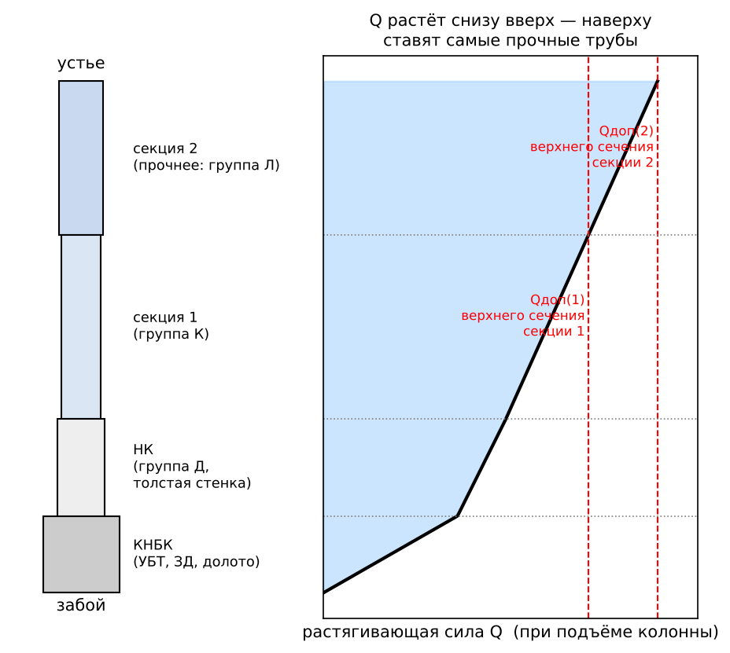
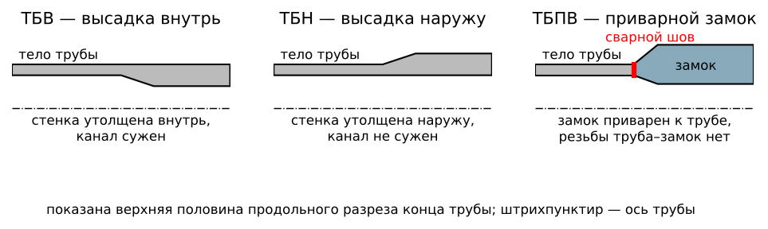
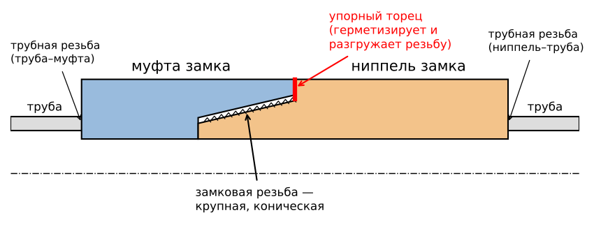
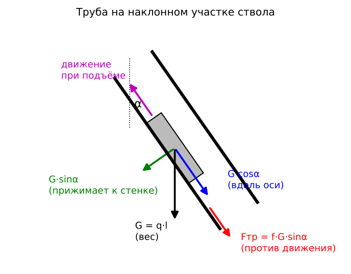
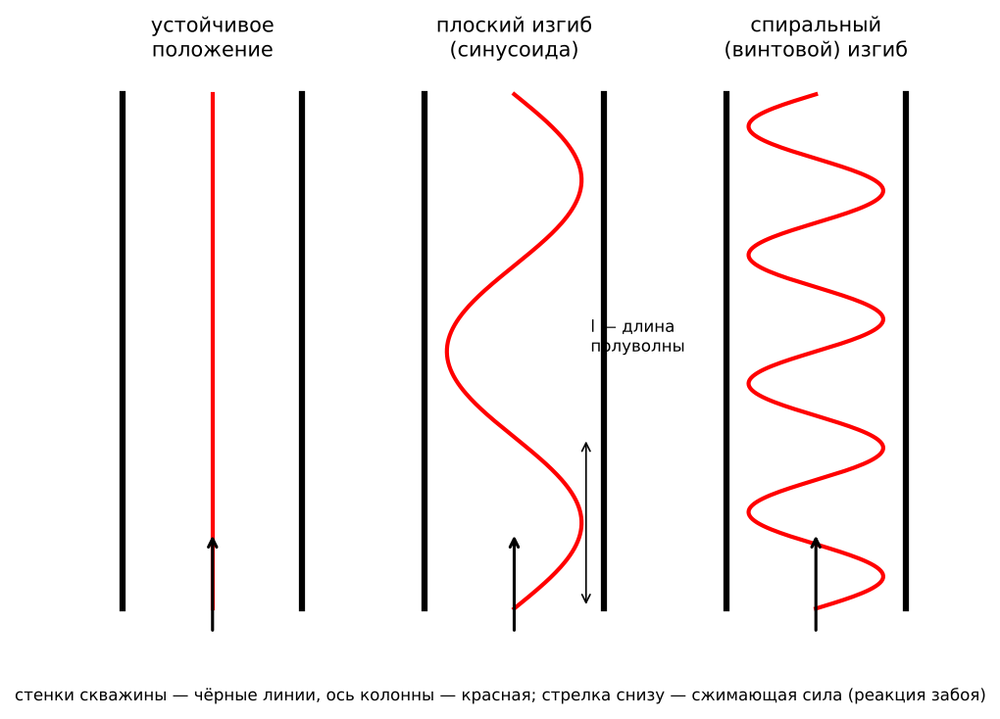

# ЛР №6 — ответы на защиту

**«Расчёт бурильной колонны на прочность по секциям при бурении вертикальных скважин»**

Как пользоваться: на защите дают **один вопрос**. Находишь его номер и переписываешь ответ целиком: текст, формулы, схему. Схему перерисовывай от руки, точные числа не нужны.

Источник: пособие Балицкого и Храбровой (ЛР №6, с. 50–56; приложение, табл. 6–8, с. 87–89). Чего в пособии нет, то взято из общего курса бурения (учебники Сарояна, Булатова, Калинина); такие места помечены *(общий курс)*.

Обозначения:
- $L$ — глубина скважины (длина колонны), м;
- $Q_\text{КНБК}$ — вес КНБК в жидкости, Н; $l_\text{КНБК}$ — длина КНБК, м;
- $Q_\text{НК}$, $l_\text{НК}$, $q_\text{НК}$ — вес, длина и масса 1 м наддолотного комплекта (НК);
- $l_{(i)}$, $q_{(i)}$, $Q_{(i)}$ — длина, масса 1 м (с учётом высадки и замков) и вес $i$-й секции бурильных труб;
- $Q_{\text{р}(i)}$ — предельная растягивающая нагрузка труб $i$-й секции (по пределу текучести), Н;
- $Q_{\text{доп}(i)}$ — допустимая растягивающая нагрузка, Н;
- $k_\text{з}$ — коэффициент запаса прочности; $\nu$ — коэффициент износа труб;
- $\Delta P_\text{зд}$, $\Delta P_\text{д}$ — перепады давления в забойном двигателе и в долоте, Па;
- $F_{(1)}$ — площадь поперечного сечения канала труб 1-й секции, м²;
- $\rho$ — плотность промывочной жидкости, $\rho_\text{м}=7850$ кг/м³ — плотность стали; $g=9{,}81$ м/с².

---

## Вопрос 1. Последовательность расчёта бурильной колонны на прочность. В каких случаях проводятся проверочные расчёты

**Основная идея.** Колонна висит на крюке. Каждое её сечение растягивается весом всего, что находится ниже. Поэтому растягивающая сила минимальна у долота и максимальна у устья. Колонну рассчитывают **снизу вверх** и собирают из **секций**: внизу трубы менее прочные, вверху — всё более прочные (больше толщина стенки и/или прочнее сталь). Основной расчёт — **статический расчёт на растяжение** при подъёме колонны.

**Последовательность расчёта (по пособию):**
1. Собирают исходные данные: способ и условия бурения, глубину $L$, диаметры долота и труб, плотности жидкости и стали, длину и вес КНБК (из ЛР №5), перепады давления в долоте и в забойном двигателе.
2. Выбирают **тип бурильных труб** по способу бурения, глубине и условиям.
3. Над КНБК ставят **наддолотный комплект (НК)** длиной 250–500 м из труб группы прочности **Д** с максимальной толщиной стенки и считают его вес:
$$Q_\text{НК}=g\,l_\text{НК}\,q_\text{НК}\left(1-\frac{\rho}{\rho_\text{м}}\right)\qquad(6.1)$$
4. Для первой секции берут трубы наименьшей прочности (по таблицам приложения) и находят допустимую нагрузку $Q_{\text{доп}(1)}$ по формуле (6.4) или (6.5).
5. Считают **длину первой секции** по формуле (6.2) (см. вопрос 6).
6. Длину округляют **вниз до числа, кратного 25 м** (длина свечи). Длина секции должна быть **не меньше 250 м**. Если получилось меньше, выбирают более прочные трубы.
7. Считают **вес секции**:
$$Q_{(i)}=g\,l_{(i)\text{у}}\,q_{(i)}\left(1-\frac{\rho}{\rho_\text{м}}\right)\qquad(6.7)$$
8. Проверяют нарастающую длину колонны:
$$l_\text{КНБК}+l_\text{НК}+l_{(1)\text{у}}+l_{(2)\text{у}}+\ldots+l_{(i)\text{у}}\le L\qquad(6.8)$$
9. Если условие выполняется (глубина ещё не набрана), берут **следующую секцию** из более прочных труб и считают её длину по формуле (6.3). Если не выполняется (секция «перебрала» глубину), длину последней секции уточняют до остатка:
$$l_{(i)\text{у}}=L-\left(l_\text{КНБК}+l_\text{НК}+l_{(1)\text{у}}+\ldots+l_{(i-1)\text{у}}\right)\qquad(6.9)$$
10. Считают **общий вес колонны**:
$$Q=Q_\text{КНБК}+Q_\text{НК}+Q_{(1)}+Q_{(2)}+\ldots+Q_{(i)}\qquad(6.10)$$

**Когда проводятся проверочные расчёты** *(общий курс)*. Основной расчёт учитывает только растяжение. Проверочные расчёты нужны, когда на колонну действуют дополнительные нагрузки:
1. **Роторное бурение**: колонна вращается. Проверяют на совместное действие растяжения и кручения и на выносливость при знакопеременном изгибе.
2. **Наклонно-направленные и горизонтальные скважины**: появляются изгиб в искривлённом стволе и большие силы трения.
3. **Большие глубины и тяжёлые колонны**: проверка труб на смятие в клиновом захвате ротора.
4. **Испытание пластов пластоиспытателем на трубах**: трубы опорожнены и сминаются наружным давлением. Проверка на наружное давление.
5. **Высокие давления промывки**: проверка на внутреннее давление.
6. **Ликвидация прихватов и ловильные работы**: колонну натягивают сверх её веса. Проверяют, какую натяжку она выдержит.
7. **Осложнённые условия**: агрессивная среда (сероводород), повышенный износ.

---

## Вопрос 2. Требования к бурильной колонне и этапы её расчёта на прочность

**Требования к бурильной колонне:**
1. Достаточная **прочность** на растяжение, сжатие, кручение и изгиб, а также против внутреннего и наружного давления.
2. **Выносливость** (сопротивление усталости) при знакопеременном изгибе во время вращения.
3. **Герметичность** резьбовых соединений, чтобы жидкость не промывала резьбу.
4. **Минимальная масса** при нужной прочности. От массы зависят нагрузка на вышку и лебёдку и предельная глубина спуска.
5. **Малые гидравлические сопротивления**: гладкий внутренний канал без резких сужений.
6. **Износостойкость** и коррозионная стойкость.
7. Быстрое и надёжное свинчивание и развинчивание, удобство СПО, ремонтопригодность.
8. Колонна должна вписываться в ствол: для промывки и выноса шлама нужен зазор между колонной и стенкой.

**Этапы расчёта на прочность:**
1. **Проектирование КНБК** (ЛР №5). Выбирают тип УБТ, число ступеней, диаметры и длины. Условие: вес КНБК в жидкости на 15 % больше нагрузки на долото, тогда бурильные трубы работают только на растяжение.
2. **Выбор наддолотного комплекта** (ЛР №6): 250–500 м труб группы Д с максимальной толщиной стенки.
3. **Расчёт бурильных труб на статическую прочность при растяжении по секциям** (ЛР №6). Подбирают тип труб, толщину стенки и группу прочности стали (Д, К, Е, Л, М). Самые прочные трубы ставят вверху. Для каждой секции должно выполняться условие
$$Q\le Q_\text{доп}=\frac{\nu\,Q_\text{р}}{k_\text{з}}.$$
4. **Проверочные расчёты** *(общий курс)*:
   - на совместное растяжение и кручение (роторное бурение);
   - на выносливость при знакопеременном изгибе (роторное бурение);
   - на наружное и внутреннее давление;
   - на смятие в клиновом захвате;
   - на изгиб в искривлённом стволе (наклонные скважины).

---

## Вопрос 3. Типы бурильных труб и их особенности

Бурильные трубы — основная (самая длинная) часть колонны. Их выпускают диаметром 60–168 мм с толщиной стенки 7–11 мм. В ЛР используются трубы диаметром 114, 127 и 140 мм.

**Стальные бурильные трубы с высаженными концами** (ГОСТ 631) *(общий курс)*. Концы трубы **высаживают**, то есть утолщают стенку. На концах нарезана трубная резьба, и туда навинчены замки. Утолщение нужно, чтобы нарезка резьбы не ослабила тело трубы.
1. **ТБВ** — с высаженными **внутрь** концами. Наружный диаметр по всей длине одинаковый, а канал на концах сужен. Минус — повышенные гидравлические сопротивления.
2. **ТБН** — с высаженными **наружу** концами. Канал по всей длине одного диаметра, гидравлические сопротивления меньше. Наружный диаметр на концах больше, поэтому зазор со стенкой меньше.
3. **ТБВК** и **ТБНК** — то же, но с **коническими стабилизирующими поясками** и трапецеидальной резьбой. Поясок плотно сопрягается с замком, разгружает резьбу от изгиба и повышает герметичность. Это более прочное и надёжное соединение, его применяют для глубокого и роторного бурения.

**Трубы с приварными замками ТБПВ** (а также ТБПН) *(общий курс)*. Замок не навинчивается, а **приваривается** к высаженному концу трубы (сваркой трением). Резьбы между трубой и замком нет, поэтому:
- соединение прочнее и полностью герметично;
- нет слабого места по трубной резьбе;
- можно применять для глубоких скважин и роторного бурения.

**Легкосплавные бурильные трубы ЛБТ** *(общий курс)*. Сделаны из алюминиевого сплава (Д16Т) со стальными замками. Плотность сплава 2780 кг/м³, почти в 3 раза меньше, чем у стали, а в буровом растворе они ещё легче. Плюсы:
- колонна меньше весит, поэтому можно бурить глубже той же буровой установкой;
- меньше силы прижатия и трения в наклонных скважинах.

Минусы: меньшая прочность и износостойкость, ограничение по температуре (около 150 °C), коррозия в щелочных растворах. Применяют в основном при турбинном бурении.

**Тяжёлые (толстостенные) бурильные трубы ТБТ** — промежуточные между бурильными трубами и УБТ (см. вопрос 10).

**Группы прочности стали** (по возрастанию прочности): **Д, К, Е, Л, М** (и выше — Р, Т). В пособии предельные растягивающие нагрузки даны для групп Д, К, Е, Л, М. Чем выше группа и толще стенка, тем больше предельная нагрузка.

**Ведущая труба** — отдельный тип с квадратным или шестигранным сечением; через ротор передаёт вращение колонне.

---

## Вопрос 4. Бурильные замки и соединительные резьбы

*(в пособии нет — общий курс)*

**Бурильный замок** соединяет бурильные трубы друг с другом. Он состоит из двух деталей:
- **ниппель** — с наружной резьбой;
- **муфта** — с внутренней резьбой.

Ниппель навинчивают на один конец трубы, а муфту — на другой (замковые детали навинчивают в нагретом состоянии, чтобы получить плотное соединение). При сборке колонны ниппель одной трубы вворачивают в муфту другой.

**Типы замков** (ГОСТ 5286):
- **ЗН** — с нормальным проходным отверстием, для труб с высадкой внутрь;
- **ЗШ** — с широким проходным отверстием, для труб с высадкой внутрь;
- **ЗУ** — с увеличенным проходным отверстием, для труб с высадкой наружу;
- **ЗШК, ЗУК** — для труб с коническими стабилизирующими поясками (ТБВК, ТБНК);
- **ЗП** — приварные замки (для ТБПВ, ТБПН).

**Соединительные резьбы.** В колонне есть два вида резьб.

1. **Трубная резьба** соединяет тело трубы с замком.
   - Для ТБВ и ТБН — треугольная коническая резьба (конусность 1:16, шаг 3,175 мм).
   - Для ТБВК и ТБНК — трапецеидальная резьба (конусность 1:32) с коническим стабилизирующим пояском.
   - Это соединение собирают один раз, на заводе или в трубной базе.
2. **Замковая резьба** (ГОСТ 28487) соединяет ниппель и муфту замков, а также УБТ, переводники, долото и забойный двигатель.
   - Крупная коническая резьба треугольного профиля с притуплёнными вершинами, конусность 1:4 или 1:6.
   - Её обозначают «З» и цифрами, например З-121, З-147, З-171.
   - Благодаря большой конусности и крупному шагу соединение свинчивается за несколько оборотов. Его можно многократно свинчивать и развинчивать при каждом СПО.
   - **Упорные торцы** ниппеля и муфты плотно прижимаются друг к другу. Они герметизируют соединение и воспринимают часть нагрузки, разгружая резьбу.

Все резьбы колонны **правые**. Левые резьбы применяют только в ловильном инструменте.

---

## Вопрос 5. Вспомогательные элементы бурильной колонны и их назначение

Вспомогательными называют элементы колонны, которые не являются бурильными трубами и УБТ.

1. **Ведущая (рабочая) труба.** Сечение квадратное или шестигранное, внутри канал для промывки. Через ротор передаёт крутящий момент колонне и при этом может перемещаться вниз по мере углубления скважины.
2. **Переводники** соединяют элементы с разными резьбами или разными диаметрами.
   - По типу концов: **П** — переходные (ниппель–муфта), **М** — муфтовые (муфта–муфта), **Н** — ниппельные (ниппель–ниппель).
   - **Предохранительный переводник** ставят под ведущей трубой. Изнашивается его резьба, а не резьба ведущей трубы, и меняют дешёвый переводник.
3. **Бурильные замки** соединяют бурильные трубы (см. вопрос 4).
4. **Центраторы и стабилизаторы.** Это короткие элементы с лопастями (прямыми или спиральными). Диаметр по лопастям близок к диаметру долота, лопасти наплавлены твёрдым сплавом. Удерживают УБТ по оси скважины, уменьшают изгиб и искривление ствола.
5. **Калибраторы** (лопастные или шарошечные) ставят над долотом. Калибруют стенку ствола до диаметра долота и центрируют долото.
6. **Протекторы** — резиновые кольца на бурильных трубах. Защищают трубы и обсадную колонну от износа при трении.
7. **Амортизаторы (демпферы)** гасят продольные вибрации и удары от долота, особенно на твёрдых породах.
8. **Ясы** (механические и гидравлические) создают удар вверх или вниз, чтобы освободить прихваченную колонну.
9. **Обратный клапан** пропускает жидкость только вниз. Защищает от выброса через трубы и от попадания шлама в забойный двигатель при остановке насосов.
10. **Фильтр** над забойным двигателем задерживает крупные частицы.
11. **Шаровой кран** на ведущей трубе перекрывает канал труб при газонефтеводопроявлении (ГНВП).

---

## Вопрос 6. Формулы для расчёта длины секций бурильных труб при бурении забойными двигателями

**Допустимая растягивающая нагрузка** на трубы $i$-й секции при турбинном бурении:
$$Q_{\text{доп}(i)}=\frac{\nu\,Q_{\text{р}(i)}}{k_\text{з}}\qquad(6.4)$$
где
- $Q_{\text{р}(i)}$ — предельная растягивающая нагрузка труб (при которой напряжение в теле трубы достигает предела текучести), берётся из табл. 7 приложения по диаметру, толщине стенки и группе прочности;
- $\nu=0{,}8$ — коэффициент износа (трубы 2-го класса, стенка частично изношена);
- $k_\text{з}=1{,}4$ — коэффициент запаса прочности при бурении забойными двигателями (табл. 8 приложения).

**Длина первой секции** (над НК):
$$l_{(1)}=\frac{Q_{\text{доп}(1)}-1{,}1\,(Q_\text{КНБК}+Q_\text{НК})-(\Delta P_\text{зд}+\Delta P_\text{д})\,F_{(1)}}{1{,}1\,g\,q_{(1)}\left(1-\dfrac{\rho}{\rho_\text{м}}\right)}\qquad(6.2)$$

Смысл формулы: верхнее сечение 1-й секции не должно нагружаться больше допустимой нагрузки. На него действуют:
- **вес всего, что ниже**: КНБК и НК (в числителе вычитается);
- **собственный вес секции** (в знаменателе, вес 1 м в жидкости);
- **гидравлическая нагрузка** $(\Delta P_\text{зд}+\Delta P_\text{д})F_{(1)}$. При работе забойного двигателя давление в трубах выше, чем в затрубье, на величину перепадов в двигателе и в долоте. Это давление действует на площадь канала и дополнительно растягивает колонну, поэтому его тоже вычитают из допустимой нагрузки;
- коэффициент **1,1** учитывает дополнительные нагрузки при подъёме колонны: трение о стенки, силы инерции при разгоне *(общий курс)*;
- множитель $\left(1-\dfrac{\rho}{\rho_\text{м}}\right)$ учитывает **архимедову силу** — в жидкости трубы легче.

**Длина каждой следующей секции**:
$$l_{(i)}=\frac{Q_{\text{доп}(i)}-Q_{\text{доп}(i-1)}}{1{,}1\,g\,q_{(i)}\left(1-\dfrac{\rho}{\rho_\text{м}}\right)}\qquad(6.3)$$
Нижнее сечение $i$-й секции уже нагружено до $Q_{\text{доп}(i-1)}$ (до предела предыдущей секции). Секция может «добавить» вес, пока нагрузка в её верхнем сечении не дойдёт до $Q_{\text{доп}(i)}$. Поэтому в числителе — разность допустимых нагрузок соседних секций.

**Дальше:**
- длину округляют вниз до числа, кратного 25 м, и проверяют, что она не меньше 250 м;
- вес секции считают по формуле (6.7);
- нарастающую длину проверяют по (6.8); когда секция доходит до глубины $L$, её длину уточняют по (6.9);
- общий вес колонны — по (6.10).

---

## Вопрос 7. Особенности расчёта бурильной колонны в наклонно-направленных скважинах

*(в пособии рассмотрены только вертикальные скважины — общий курс)*

В вертикальной скважине растягивающая сила в сечении равна весу колонны ниже этого сечения. В наклонной скважине так считать нельзя. Отличия:

1. **Вес раскладывается на две составляющие.** На участке с зенитным углом $\alpha$ вдоль оси действует только $G\cos\alpha$, а составляющая $G\sin\alpha$ прижимает трубы к нижней стенке.
2. **Появляются силы трения** о стенку: $F_\text{тр}=f\,G\sin\alpha$, где $f$ — коэффициент трения (0,2–0,4). При подъёме трение направлено вниз и **увеличивает** натяжение, при спуске — уменьшает.
3. Поэтому ствол делят на **интервалы**: вертикальный, набора угла, стабилизации (прямолинейный наклонный), снижения угла. Силу считают **снизу вверх по интервалам**. На прямолинейном наклонном участке длиной $l$ при подъёме:
$$Q_\text{в}=Q_\text{н}+q\,l\,(\cos\alpha+f\sin\alpha),$$
   где $Q_\text{н}$ и $Q_\text{в}$ — силы в нижнем и верхнем сечениях участка, $q$ — вес 1 м труб в жидкости.
4. **На искривлённом участке** натянутая колонна прижимается к стенке тем сильнее, чем больше натяжение (как канат на барабане). Сила растёт по экспоненте:
$$Q_\text{в}\approx Q_\text{н}\,e^{f\theta},$$
   где $\theta$ — угол изменения направления ствола на участке, рад.
5. **Дополнительное напряжение изгиба** в искривлённом стволе радиусом $R$:
$$\sigma_\text{и}=\frac{E\,d_\text{н}}{2R}.$$
   Его складывают с напряжением растяжения. При вращении оно знакопеременное, отсюда проверка на выносливость.
6. **Нагрузку на долото** создаёт только осевая составляющая веса КНБК $G\cos\alpha$, к тому же уменьшенная трением. УБТ нужно больше, а в горизонтальных скважинах их переносят выше, в вертикальную часть.
7. **Износ** замков и обсадной колонны в местах прижатия больше. Ставят протекторы, снижают трение (см. вопрос 12).

---

## Вопрос 8. Особенности расчёта бурильной колонны на прочность при роторном бурении

При роторном бурении вращается вся колонна. На неё действуют дополнительные нагрузки:
- **крутящий момент** от ротора: в трубах возникают касательные напряжения кручения;
- **знакопеременный изгиб**: изогнутая вращающаяся колонна за каждый оборот изгибается то в одну, то в другую сторону. Это вызывает **усталость металла** — главную причину поломок труб при роторном бурении.

**Как это учтено в ЛР №6 (по пособию):**
1. Допустимая нагрузка считается по формуле
$$Q_{\text{доп}(i)}=\frac{\nu\,Q_{\text{р}(i)}}{1{,}04\cdot k_\text{з}}.\qquad(6.5)$$
   Множитель **1,04** учитывает касательные напряжения от крутящего момента, то есть совместное действие растяжения и кручения. Допустимое растяжение уменьшается примерно на 4 %.
2. **Коэффициент запаса больше**: $k_\text{з}=1{,}5$ при роторном бурении против 1,4 при бурении забойными двигателями (табл. 8 приложения). Общий запас $1{,}04\cdot1{,}5=1{,}56$.
3. Забойного двигателя нет, поэтому в формуле (6.2) $\Delta P_\text{зд}=0$ и остаётся только перепад в долоте $\Delta P_\text{д}$.
4. **Наддолотный комплект** из труб группы Д с толстой стенкой особенно важен. Именно над УБТ знакопеременный изгиб самый сильный.

**Проверочные расчёты при роторном бурении** *(общий курс)*:
1. **На совместное действие растяжения и кручения.** Крутящий момент находят по мощности на вращение:
$$M_\text{кр}=\frac{N}{\omega},\qquad N=N_\text{хв}+N_\text{д},$$
   где $N_\text{хв}$ — мощность на холостое вращение колонны, $N_\text{д}$ — мощность на долоте, $\omega$ — угловая скорость. Касательное напряжение $\tau=M_\text{кр}/W_\text{кр}$, нормальное от растяжения $\sigma=Q/F$. Эквивалентное напряжение:
$$\sigma_\text{экв}=\sqrt{\sigma^2+4\tau^2}\le\frac{\sigma_\text{т}}{n}.$$
2. **На выносливость.** Амплитуда переменных напряжений изгиба не должна превышать предел выносливости с учётом запаса. Длину полуволны изгиба считают по формуле Саркисова, напряжение — по формуле
$$\sigma_\text{и}=\frac{\pi^2EIf}{W\,l^2}.$$

---

## Вопрос 9. Проверочные расчёты бурильной колонны

*(в пособии нет — общий курс)*

Основной расчёт (ЛР №6) — статический расчёт на растяжение. Затем колонну проверяют на другие виды нагружения. Во всех проверках действующее напряжение (или нагрузка) должно быть меньше предельного, делённого на коэффициент запаса.

1. **На совместное действие растяжения и кручения** (роторное бурение):
$$\sigma=\frac{Q}{F},\qquad\tau=\frac{M_\text{кр}}{W_\text{кр}},\qquad\sigma_\text{экв}=\sqrt{\sigma^2+4\tau^2}\le\frac{\sigma_\text{т}}{n}.$$
   Здесь $F$ — площадь сечения тела трубы, $W_\text{кр}$ — полярный момент сопротивления, $\sigma_\text{т}$ — предел текучести стали.
2. **На выносливость (усталость)** при знакопеременном изгибе (роторное бурение, наклонные скважины). Запас по выносливости:
$$n_\sigma=\frac{\sigma_{-1}}{\sigma_a}\ge[n],$$
   где $\sigma_{-1}$ — предел выносливости трубы (с учётом резьбы), $\sigma_a$ — амплитуда напряжений изгиба.
3. **На изгиб в искривлённом стволе**: $\sigma_\text{и}=\dfrac{E\,d_\text{н}}{2R}$. Это напряжение складывают с растягивающим.
4. **На наружное избыточное давление (смятие).** Опасно, когда трубы опорожнены: при испытании пластов пластоиспытателем или при спуске с закрытым обратным клапаном. Условие:
$$p_\text{нар}\le\frac{p_\text{кр}}{n},$$
   где $p_\text{кр}$ — критическое давление смятия трубы.
5. **На внутреннее давление** (высокие давления промывки, опрессовка): $p_\text{вн}\le p_\text{т}/n$.
6. **На смятие в клиновом захвате** ротора. Клинья сжимают трубу, и при большом весе колонны она может смяться. Допустимый вес колонны в клиньях меньше предельной растягивающей нагрузки:
$$Q\le\frac{Q_\text{р}}{C\,n},$$
   где $C>1$ — коэффициент, учитывающий охват трубы клиньями.
7. **На допустимую натяжку** при ликвидации прихватов: проверяют, какую силу сверх веса колонны можно приложить, не порвав трубы.

---

## Вопрос 10. Наддолотный комплект и ТБТ

**Наддолотный комплект (НК)** *(по пособию)*:
- это часть колонны **сразу над КНБК (над УБТ)**, длиной **250–500 м**;
- его собирают из труб **группы прочности Д** с **максимальной толщиной стенки**;
- назначение — **предотвращать аварии с бурильными трубами от знакопеременных напряжений изгиба**.

Почему именно над УБТ:
- здесь жёсткая УБТ переходит в гибкие трубы, и изгиб сосредоточен на переходе;
- рядом нейтральное сечение, поэтому трубы то растягиваются, то сжимаются;
- длина полуволн изгиба здесь меньше (формула Саркисова), а напряжения больше;
- вибрации от долота сильнее всего вблизи забоя.

Почему группа Д и толстая стенка:
- сталь группы Д — самая пластичная, меньше чувствительна к концентрации напряжений и лучше сопротивляется усталости;
- толстая стенка даёт большую жёсткость, плавный переход жёсткости от УБТ к трубам и меньшие напряжения изгиба.

Вес НК:
$$Q_\text{НК}=g\,l_\text{НК}\,q_\text{НК}\left(1-\frac{\rho}{\rho_\text{м}}\right).\qquad(6.1)$$
Его учитывают при расчёте длины первой секции (формула 6.2).

**ТБТ — толстостенные (тяжёлые) бурильные трубы** (HWDP) *(общий курс)*:
- По массе и жёсткости они **промежуточные между бурильными трубами и УБТ**. Стенка толстая, у замков удлинённые высадки, **посередине тела — утолщённый износостойкий поясок** (центральная высадка), который защищает трубу от износа о стенку.
- Длина как у обычной бурильной трубы (около 9 м), их можно ставить на подсвечник и свинчивать без особых приёмов.
- Назначение:
  1. **Переходная секция** между УБТ и бурильными трубами: обеспечивает плавный переход жёсткости и снижает усталостные поломки, как и НК.
  2. В **наклонных и горизонтальных** скважинах заменяют часть УБТ. Они могут работать в сжатии без опасного изгиба, меньше контактируют со стенкой (касание по замкам и пояску), поэтому меньше трение и риск прихвата.
  3. Создают дополнительную нагрузку на долото.

---

## Вопрос 11. Условие возникновения изгиба в бурильной колонне и меры его предотвращения

**Причина изгиба.** Нижнюю часть колонны снизу сжимает реакция забоя, равная нагрузке на долото $P_\text{д}$. Пока сжимающая сила меньше **критической**, ось колонны остаётся прямой. Когда сила превышает критическую, колонна **теряет продольную устойчивость** и изгибается, упираясь в стенки скважины. Сначала ось изгибается плоской синусоидой, а при большей силе ложится на стенку спиралью.

**Условие возникновения изгиба:**
$$P_\text{д}>P_\text{кр}.$$

**Формула Эйлера** для стержня длиной $l$ (собственный вес не учитывается):
$$P_\text{кр}=\frac{\pi^2EI}{(\mu l)^2},$$
где $EI$ — жёсткость сечения на изгиб, $\mu$ — коэффициент закрепления концов.

**Формула Эйлера–Динника** *(общий курс)* — для вертикального стержня, сжимаемого **собственным весом**, как бурильная колонна. Критическая нагрузка (вес сжатой части колонны):
$$P_\text{кр}\approx1{,}94\,\sqrt[3]{EI\,q^2},$$
где $q$ — вес 1 м труб в жидкости, $I=\dfrac{\pi(d_\text{н}^4-d_\text{в}^4)}{64}$ — момент инерции сечения трубы.

Для обычных бурильных труб ($EI$ мало) критическая нагрузка — всего **несколько кН**. Значит, нагружать долото их весом нельзя, они сразу изогнутся.

**Изгиб вращающейся колонны** (роторное бурение). Изогнутая колонна вращается, центробежные силы увеличивают прогиб. Напряжение изгиба в каждой точке за оборот меняет знак, отсюда **усталостные поломки**. Напряжение изгиба:
$$\sigma_\text{и}=\frac{\pi^2EIf}{W\,l^2},\qquad f=\frac{D_\text{с}-d_\text{н}}{2},$$
где $f$ — стрела прогиба, $l$ — длина полуволны (по формуле Саркисова), $W$ — момент сопротивления сечения.

**Меры предотвращения изгиба:**
1. Создавать нагрузку на долото **весом УБТ** так, чтобы **нейтральное сечение было в УБТ** ($Q_\text{КНБК}\ge1{,}15P_\text{д}$, ЛР №5). Бурильные трубы тогда только растянуты.
2. Брать УБТ **как можно большего диаметра**, квадратные УБТ: жёсткость $EI\sim d^4$, критическая сила растёт.
3. Ставить **центраторы**: они уменьшают свободную длину и длину полуволны изгиба.
4. Обеспечивать **плавный переход жёсткости**: ступени УБТ ($d_\text{бт}/d_\text{УБТ}\ge0{,}75$), **наддолотный комплект** из толстостенных труб, **ТБТ**.
5. Не превышать критическую нагрузку на долото, правильно подбирать частоту вращения.

---

## Вопрос 12. Способы уменьшения силы трения между бурильной колонной и стенками скважины

*(в пособии нет — общий курс)*

Сила трения
$$F_\text{тр}=f\,N,$$
где $f$ — коэффициент трения, $N$ — сила прижатия колонны к стенке. На наклонном участке $N\approx q\,l\sin\alpha$, на искривлённом добавляется прижатие от натяжения колонны. Значит, трение уменьшают двумя путями: **снижают коэффициент трения** и **снижают силу прижатия**.

**1. Снижение коэффициента трения:**
- **смазочные добавки** в буровой раствор: нефть, графит, растительные масла, специальные смазки (СМАД, ФК-2000 и др.), стеклянные или полимерные шарики;
- **растворы на углеводородной основе** — у них самый низкий коэффициент трения;
- **тонкая, плотная и гладкая фильтрационная корка**: малая водоотдача раствора, низкое содержание твёрдой фазы;
- **хорошая очистка ствола от шлама**, чтобы не образовывались шламовые подушки в наклонных участках.

**2. Снижение силы прижатия:**
- **облегчённая колонна**: ЛБТ, ТБТ вместо УБТ в наклонной части; УБТ переносят выше, в вертикальный участок;
- **плавный профиль ствола** с малой интенсивностью искривления, без резких перегибов («желобов»);
- **калибровка и проработка ствола**, чтобы ствол был гладким;
- **минимальная плотность раствора**: меньше перепад давления между скважиной и пластом, меньше дифференциальный прижим колонны к корке.

**3. Технологические приёмы:**
- **вращение колонны** (роторное бурение, роторные управляемые системы): при вращении сила трения направлена в основном по окружности, а осевое трение резко уменьшается;
- **расхаживание** колонны, не оставлять её без движения против проницаемых пластов (опасность дифференциального прихвата);
- **осцилляторы (вибраторы)** в колонне: вибрация уменьшает трение покоя;
- **протекторы и центраторы с роликами или вращающимися втулками**: колонна касается стенки не телом трубы, а протектором;
- **спиральные УБТ** и трубы с меньшей площадью контакта со стенкой.
